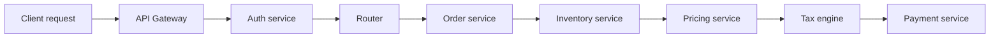
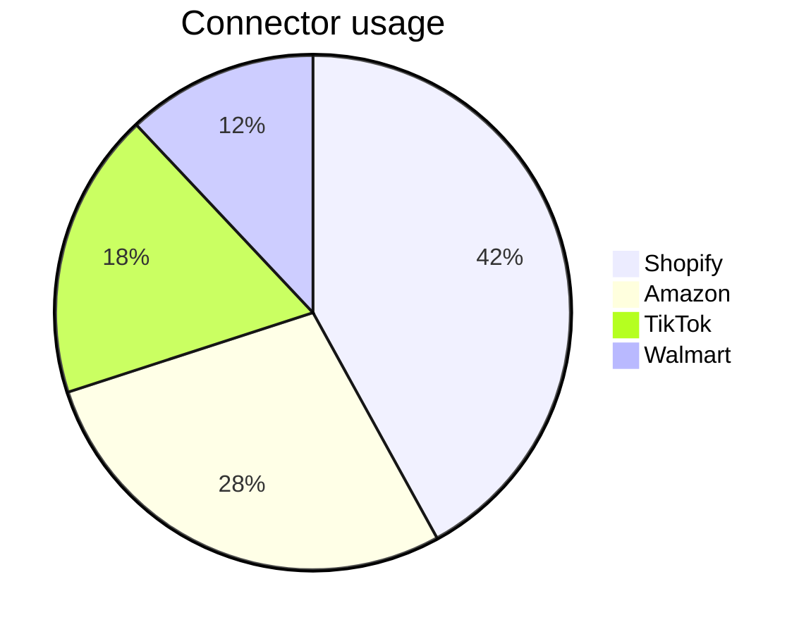
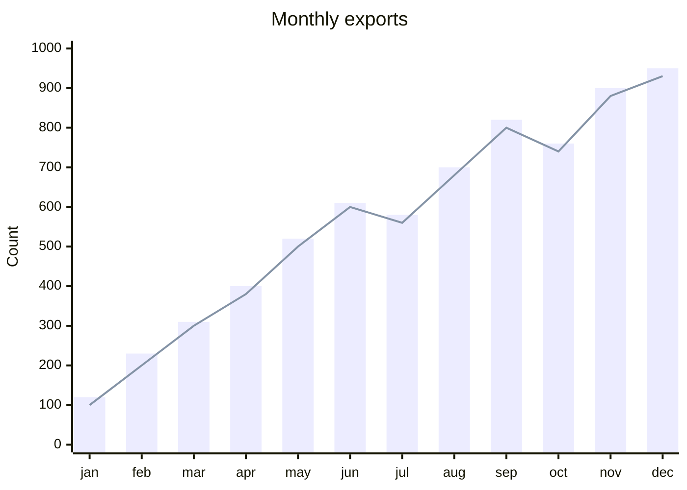
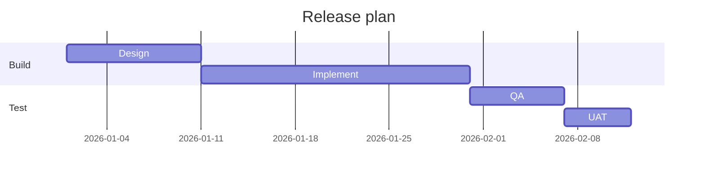
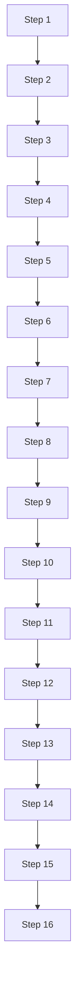
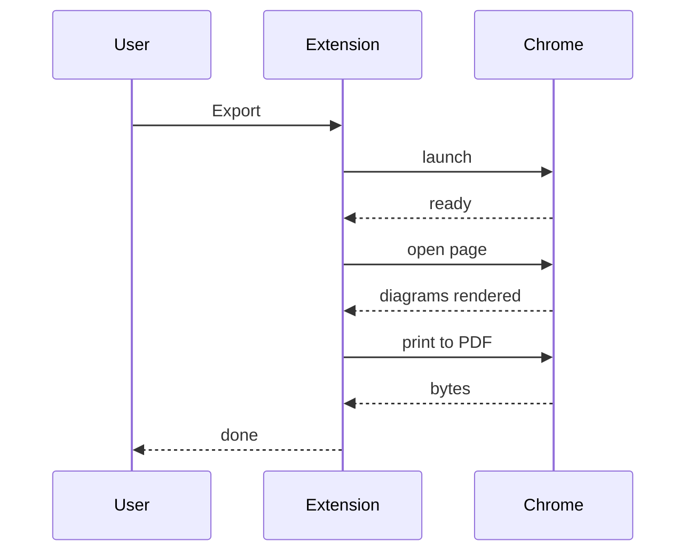

# Layout Regression Sample

Export this file before each release and check the PDF: every diagram readable and centred, no page that is mostly blank, the table split across pages with its header repeated, long code lines wrapped, and the broken diagram shown as a red error box.

## 1. Wide flowchart (LR)



## 2. Pie chart



## 3. XY chart



## 4. Gantt



## 5. Architecture Diagrams

### 5.1 Tall flowchart (taller than a page)



### 5.2 Sequence



## 6. Broken diagram (should show an error box)

```mermaid
flowchart TD
  A --> B -->
  this is not valid ((
```

## 7. Long table

Text before the table so it starts mid-page.

| # | Name | Description | Status |
| --- | --- | --- | --- |
| 1 | Alpha | Lorem ipsum dolor sit amet consectetur | OK |
| 2 | Bravo | Lorem ipsum dolor sit amet consectetur | OK |
| 3 | Charlie | Lorem ipsum dolor sit amet consectetur | OK |
| 4 | Delta | Lorem ipsum dolor sit amet consectetur | OK |
| 5 | Echo | Lorem ipsum dolor sit amet consectetur | OK |
| 6 | Foxtrot | Lorem ipsum dolor sit amet consectetur | OK |
| 7 | Golf | Lorem ipsum dolor sit amet consectetur | OK |
| 8 | Hotel | Lorem ipsum dolor sit amet consectetur | OK |
| 9 | India | Lorem ipsum dolor sit amet consectetur | OK |
| 10 | Juliet | Lorem ipsum dolor sit amet consectetur | OK |
| 11 | Kilo | Lorem ipsum dolor sit amet consectetur | OK |
| 12 | Lima | Lorem ipsum dolor sit amet consectetur | OK |
| 13 | Mike | Lorem ipsum dolor sit amet consectetur | OK |
| 14 | November | Lorem ipsum dolor sit amet consectetur | OK |
| 15 | Oscar | Lorem ipsum dolor sit amet consectetur | OK |
| 16 | Papa | Lorem ipsum dolor sit amet consectetur | OK |
| 17 | Quebec | Lorem ipsum dolor sit amet consectetur | OK |
| 18 | Romeo | Lorem ipsum dolor sit amet consectetur | OK |
| 19 | Sierra | Lorem ipsum dolor sit amet consectetur | OK |
| 20 | Tango | Lorem ipsum dolor sit amet consectetur | OK |
| 21 | Uniform | Lorem ipsum dolor sit amet consectetur | OK |
| 22 | Victor | Lorem ipsum dolor sit amet consectetur | OK |

## 8. Long code line

```typescript
// a very long line that must wrap inside the page instead of being cut off at the right edge, which also used to shrink the whole document
export function exportMarkdownToPdf(markdownPath: string, outputPath: string): Promise<string> {
  return Promise.resolve(outputPath);
}
```
