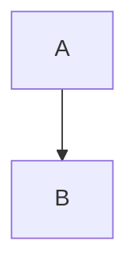

# MD-PDF Exporter — Support

Thank you for using **MD-PDF Exporter**. This page explains how to get help, report issues, and resolve common problems.

**Repository:** [github.com/ramdeoangh/pdfexporter](https://github.com/ramdeoangh/pdfexporter)

---

## Get help

| Channel | Use for |
| --- | --- |
| [GitHub Issues](https://github.com/ramdeoangh/pdfexporter/issues) | Bug reports, feature requests, questions |
| [GitHub Discussions](https://github.com/ramdeoangh/pdfexporter/discussions) | General questions and ideas (if enabled) |

When opening an issue, please include:

- VS Code or **Cursor** version
- Extension version (**MD-PDF Exporter**)
- Operating system (Windows / macOS / Linux)
- Steps to reproduce the problem
- Error message (copy from the notification)
- A sample `.md` file or snippet if the issue is export/preview related

---

## Quick start

### MD Preview

1. Open a `.md` file
2. Right-click → **MD-PDF Exporter** → **MD Preview**
3. Or `Ctrl+Shift+M` (Mac: `Cmd+Shift+M`)

The preview shows the actual PDF that **Export to PDF** produces (same pages, breaks, header and footer), including unsaved edits. It refreshes when you save; click **Refresh** to see unsaved changes, or **Export PDF** to save the file. Each refresh takes a couple of seconds because it renders the real PDF.

### Export to PDF

1. Open a `.md` file
2. Right-click → **MD-PDF Exporter** → **Export to PDF**
3. Or `Ctrl+Shift+E` (Mac: `Cmd+Shift+E`)

The PDF is saved next to the Markdown file unless you set `pdfexporter.outputDirectory`. It opens in your **system PDF viewer** (not the built-in editor tab).

### Export a folder

1. Right-click a folder in the Explorer → **Export Folder to PDF**
2. Set `pdfexporter.batchRecursive` to `true` to include subfolders

### Front matter

Per-document YAML at the top of a `.md` file can set title, author, date, custom logo, headers, footers, and other PDF options. See `examples/front-matter-sample.md`.

---

## Requirements

| Requirement | Details |
| --- | --- |
| **Chrome or Edge** | Required for PDF export (local browser, not uploaded anywhere) |
| **VS Code / Cursor** | Version `1.85.0` or newer |

Node.js is **not** required. Since 0.2.4, exports run on the editor's own runtime.

---

## Troubleshooting

When an export fails, click **Show Log** on the error notification (or open the **Output** panel → **MD-PDF Exporter**) for the full error. Include it when you open an issue.

---

### "Cannot write file.pdf: the file is open in another program"

The previous PDF is still open in a viewer that locks it (for example Adobe Acrobat or Reader).

**Fix:** close the PDF and export again, or set `pdfexporter.outputDirectory` to another folder.

---

### Mermaid diagram shows "Mermaid diagram could not be rendered"

The diagram has a syntax error. The red box shows Mermaid's error message and the diagram source; fix the line it points to and export again. Other diagrams in the document still render.

---

### Remote images (`https://…`) are missing

Images that do not load within 15 seconds (for example blocked by a proxy or VPN) are skipped so the export still completes. Download the image next to the `.md` file and use a relative path instead.

---

### PDF export failed: "Failed to launch the browser process"

Chrome or Edge could not be started.

**Fix:**

1. Install [Google Chrome](https://www.google.com/chrome/) or use Microsoft Edge
2. Open Settings → search `pdfexporter.executablePath`
3. Set the full path to your browser, for example:

```json
"pdfexporter.executablePath": "C:\\Program Files\\Google\\Chrome\\Application\\chrome.exe"
```

Or for Edge:

```json
"pdfexporter.executablePath": "C:\\Program Files (x86)\\Microsoft\\Edge\\Application\\msedge.exe"
```

4. Restart VS Code / Cursor and try again

---

### Mermaid diagram shows as code in the PDF

**Fix:**

1. Ensure `pdfexporter.renderMermaid` is `true` (default)
2. Use a standard fenced block:

````markdown

````

3. Increase timeout if the diagram is large: `pdfexporter.exportTimeout` (default `60000` ms)

---

### Local images missing in PDF or preview

**Fix:**

- Use relative paths from the `.md` file: ``
- Ensure the image file exists on disk
- Avoid broken links or paths outside the workspace

---

### MD Preview panel is blank or shows an error

The preview runs the same export as **Export to PDF**, so the same fixes apply (browser path, timeouts, images). Click **Show Log** in the red banner for the full error.

**Fix:**

1. Click **Refresh** in the preview toolbar
2. Reload the window: Command Palette → **Developer: Reload Window**
3. Check the sample file: `examples/sample.md`
4. Open an issue with the error text from the log

---

### Extension not listed in Marketplace search

If you installed from a `.vsix` file, the extension appears under **Installed**, not Marketplace search.

Search **Installed** for: `MD-PDF Exporter` or `@installed pdfexporter`

---

### Right-click menu does not appear

**Fix:**

1. Confirm the file extension is `.md` or `.markdown`
2. Right-click the file in the **Explorer** or inside the **editor**
3. Look for submenu **MD-PDF Exporter**
4. Reload the window after installing or updating the extension

---

### PDF opens with an error in the built-in viewer (e.g. tomoki1207.pdf)

Error such as `Requesting object that isn't resolved yet pattern_p3_1`.

The PDF is valid; the viewer is not. That extension bundles PDF.js 2.10 (2021), which fails on color emoji (✅, ⏳, …) used on more than one page. Since **0.2.5** the exporter draws emoji as images, so new exports open without this error. Re-export PDFs made with older versions.

If another PDF still fails in that viewer:

1. Open the `.pdf` from Explorer in Edge, Chrome or Acrobat (the export notification has **Open in Default Viewer**)
2. Or set your OS default PDF app and use **Reveal in File Explorer** from the success notification

---

## Settings reference

| Setting | Default | Description |
| --- | --- | --- |
| `pdfexporter.outputDirectory` | `""` | PDF output folder (empty = same folder as `.md`; relative paths start from the `.md` file's folder) |
| `pdfexporter.executablePath` | `""` | Path to Chrome/Edge |
| `pdfexporter.pageFormat` | `A4` | A4, Letter, Legal, Tabloid |
| `pdfexporter.renderMermaid` | `true` | Render Mermaid in PDF and preview |
| `pdfexporter.mermaidTheme` | `default` | default, dark, forest, neutral |
| `pdfexporter.showLogo` | `true` | Logo in exported PDF |
| `pdfexporter.headerFooter.enabled` | `true` | Header and footer in PDF |
| `pdfexporter.headerFooter.showPageNumbers` | `true` | Page numbers in footer |
| `pdfexporter.batchRecursive` | `false` | Subfolders when exporting a folder |
| `pdfexporter.exportTimeout` | `60000` | Max wait for rendering (ms) |

---

## Privacy

- Markdown is processed **locally** on your machine
- PDF export uses your **local** Chrome or Edge installation
- **No** document content is sent to external servers for rendering
- Mermaid diagrams are rendered locally (bundled `mermaid.js`)

---

## Feature requests

We welcome ideas. Please open a [GitHub Issue](https://github.com/ramdeoangh/pdfexporter/issues) with the label **enhancement** (or describe it in the title), including:

- What you want to achieve
- Example Markdown or screenshot
- Why the built-in preview or export is not enough

---

## License

MIT — see [LICENSE](LICENSE) in the repository.
